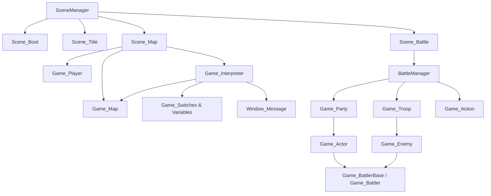

# NUSV Engine - Technical Architecture & Clean-Room Specification
**Status:** Open Source Core Specification  
**Version:** 0.1.0-alpha  
**Derived From:** Graphify & REA Architectural Analysis of RPG Maker MZ  

---

## 1. Ringkasan Eksekutif & Prinsip Clean-Room
NUSV Engine adalah game engine RPG 2D open source yang dirancang untuk kompatibilitas konsep, data format, dan alur kerja pembuatan game role-playing klasik berbasis grid/tile dan turn-based/time-progress combat.

### Prinsip Clean-Room Engineering
1. **Pemisahan Antara Analisis & Implementasi:**
   - REA dan Ghidra digunakan semata-mata untuk mengidentifikasi antarmuka teknis (PE imports, subsistem native Qt5/WebEngine) dan spesifikasi runtime.
   - Graphify memetakan relasi abstraksi (3,607 AST nodes, 7,674 edges).
   - Seluruh baris kode NUSV Engine ditulis ulang dari awal (*clean-room clean-slate implementation*) dengan arsitektur modern TypeScript/ES Modules tanpa menyalin kode biner atau hak cipta proprietary.
2. **Open Source & Extensible:**
   - Tidak terikat pada wrapper komersial native.
   - Dapat dijalankan langsung di Web modern (WebGL / WebGPU / Canvas), desktop (Electron / Tauri / Wasm), dan mobile.

---

## 2. Fondasi Arsitektur (Berdasarkan Graphify God Nodes)

Analisis Graphify menemukan 10 node penghubung utama (*God Nodes*) yang menjadi tulang punggung sistem RPG Maker MZ:



### 10 Pilar Komponen Utama NUSV Engine:
1. **`Game_Interpreter` (Virtual Machine / Event Runner):**
   - Menjalankan byte-code/JSON array dari daftar command event (Code 101: Show Message, Code 121: Control Switches, Code 201: Transfer Player, dll.).
   - Mendukung async wait, nested branches (Conditional Branch), dan loop.
2. **`Game_Map` (Grid & Collision Subsystem):**
   - Mengelola koordinat map (X, Y), scroll offsets, loop horizontal/vertical, serta auto-tile passability bitflags (0x01: Down, 0x02: Left, 0x04: Right, 0x08: Up).
3. **`Game_CharacterBase` & `Game_Player` (Entity & Movement):**
   - Pergerakan tile-by-tile, interpolasi posisi real-time, handling trigger sentuhan/tombol (Action Button, Player Touch, Event Touch, Autorun, Parallel).
4. **`Game_BattlerBase` & `Game_Battler` (Combat Mathematics):**
   - Formula stat parametrik (MHP, MMP, ATK, DEF, MAT, MDF, AGI, LUK).
   - Evaluasi state buff/debuff dan trait modifiers.
5. **`Game_Action` (Combat Action Pipeline):**
   - Evaluasi target (Single Enemy, All Enemies, Ally, User).
   - Perhitungan damage formula, critical hit, akurasi, dan element rate.
6. **`Game_Actor` & `Game_Party` (Player State & Inventory):**
   - Manajemen gold, item, senjata, armor, perolehan EXP, dan kurva level up.
7. **`Window_Selectable` & `Window_Base` (Modular UI Hierarchy):**
   - Sistem hierarki window berbasis render canvas yang responsif dengan navigasi kursor keyboard/gamepad/mouse.
8. **`Scene_Manager` (Scene Lifecycle Stack):**
   - State machine scene (`goto`, `push`, `pop`, `update`, `render`).
9. **`DataManager` (Data Schemas & Persistence):**
   - Loader data JSON standar yang kompatibel dengan format database RPG.
10. **`Graphics` & `Audio` (Hardware Abstraction Layer):**
    - Abstraksi rendering 2D (WebGL / Canvas API) dan pemutar audio WebAudio API (BGM, BGS, ME, SE).

---

## 3. Struktur Codebase NUSV Engine

```
nusv-engine/
├── craft.json                # Craft Anything project manifest
├── package.json              # Modern ES module project
├── index.html                # Engine web launcher / standalone runner
└── src/
    ├── core/                 # Low-level abstractions
    │   ├── Graphics.ts       # Canvas 2D / WebGL rendering context
    │   ├── Input.ts          # Keyboard, mouse, touch, gamepad input router
    │   ├── Audio.ts          # WebAudio manager (BGM, SE)
    │   └── Math2D.ts         # Point, Rectangle, Vector2D
    ├── data/                 # Data schemas & Database loader
    │   ├── Schema.ts         # TypeScript interfaces untuk data RPG
    │   └── DataManager.ts    # JSON loader & Save/Load serializer
    ├── objects/              # Game State Models & VM
    │   ├── Game_Temp.ts      # Temporary runtime flags
    │   ├── Game_System.ts    # BGM memory, save count, play time
    │   ├── Game_Switches.ts  # Global Boolean switches
    │   ├── Game_Variables.ts # Global numeric variables
    │   ├── Game_Interpreter.ts # Event command execution engine
    │   ├── Game_Map.ts       # Tilemap data & event container
    │   ├── Game_Character.ts # Base moving entity
    │   ├── Game_Player.ts    # Main player avatar
    │   ├── Game_Event.ts     # Map interactive event entity
    │   ├── Game_Actor.ts     # Party hero model
    │   └── Game_Party.ts     # Active party manager
    ├── scenes/               # Scene State Machine
    │   ├── SceneManager.ts   # Scene transition & loop controller
    │   ├── Scene_Base.ts     # Base scene lifecycle
    │   ├── Scene_Boot.ts     # Asset preloading
    │   ├── Scene_Title.ts    # Start game, continue, options
    │   └── Scene_Map.ts      # Active gameplay screen
    └── ui/                   # Modular Canvas UI
        ├── Window_Base.ts    # Frame & content box
        ├── Window_Selectable.ts # Grid cursor navigation
        └── Window_Message.ts # RPG dialogue & choice box
```

